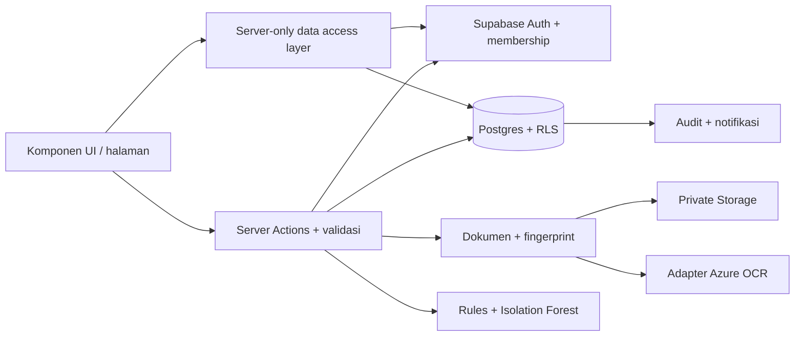

# Arsitektur InvoFin

## Keputusan implementasi

InvoFin saat ini adalah **modular monolith** Next.js, bukan kumpulan microservices yang sudah dideploy terpisah. Untuk MVP tim kampus, satu deployment menjaga transaksi, debugging, dan operasi tetap sederhana. Batas modul dipersiapkan untuk pemisahan layanan berdasarkan beban dan kepemilikan data. Tidak ada broker, Kubernetes, atau library state global yang belum diperlukan.

Proposal memuat tiga pengguna bisnis: vendor UMKM, anchor buyer, lender. Risk Officer dan Admin merupakan dua peran operasional. Hak akses ditentukan membership organisasi yang diperiksa server, bukan pilihan peran di browser.

## Batas kode dan kepemilikan

| Area | Lokasi | Tanggung jawab |
| --- | --- | --- |
| Routing | `app/` | Entry point, guard peran, layout, error boundary |
| Presentasi workspace | `modules/dashboard/` | DTO ringkasan, kalkulasi, grafik, tabel, fixture demo |
| Navigasi & peran | `modules/workspace/` | Satu konfigurasi lima peran dan penanda navigasi aktif |
| Marketing | `modules/marketing/` | Halaman pengenalan produk |
| Komponen sistem | `components/ui/` | Primitif Radix/shadcn, fokus, dialog, input |
| Identitas | `lib/auth/`, `lib/supabase/` | Session, otorisasi, adapter Supabase |
| Dokumen | `lib/documents/` | Validasi tipe, hash SHA-256, adapter OCR |
| Risiko | `lib/risk/` | Rules, penilaian dan deteksi anomali |
| Pendanaan | `lib/funding/`, `app/actions/funding.ts` | Pricing dan komitmen; bukan transfer dana riil |
| Kontrak database | `lib/database.types.ts`, `supabase/` | Tipe, migrasi, RLS dan fungsi transaksi |

Dashboard overview memakai DAL server-only baru di `modules/dashboard/data.ts`. Halaman operasional lain masih memakai pola query server yang sudah ada; migrasi seluruh akses data ke DAL dapat dilakukan bertahap. Tidak mengklaim seluruh repository telah direstrukturisasi menjadi layanan independen.

## Alur data dan keamanan

1. Browser mengirim input melalui Server Actions. Validasi Zod tetap dijalankan di server.
2. Server memvalidasi pengguna melalui `auth.getUser()` dan membership. Konteks sesi di-cache hanya sepanjang request React, bukan lintas pengguna.
3. Query pengguna memakai session client supaya RLS tetap berlaku. Dashboard membatasi query, memilih field eksplisit, dan menghasilkan DTO tanpa dokumen mentah, rekening, token, atau kredensial.
4. Data vendor/buyer dibatasi organisasi. Lender menerima ringkasan peluang; akses dokumen mentah tetap ditolak.
5. Upload dibatasi 10 MB, allowlist MIME dan pemeriksaan signature. Signature bukan pemindai malware atau pembuktian keaslian dokumen. Berkas tetap berada di bucket privat, diakses memakai signed URL singkat.
6. Callback auth hanya mengizinkan tujuan workspace di origin yang sama. Service-role client diberi batas `server-only`.
7. Ekspor CSV menetralkan awalan formula. Header nosniff, frame denial, referrer policy, dan permissions policy diterapkan.
8. Tidak ada perubahan database live atau transaksi uang dalam pekerjaan ini. Migrasi/RLS lama harus diuji terhadap database InvoFin khusus sebelum pilot.

Ringkasan dashboard memuat hingga 500 invoice terbaru, marketplace 100 peluang, komitmen 1.000 baris. Angka yang ditampilkan mengikuti subset tersebut; untuk skala produksi ganti dengan agregasi SQL terotorisasi dan pagination server. Grafik menunjukkan nilai invoice pada status saat ini berdasarkan bulan pengajuan, bukan riwayat pergerakan saldo.

## Pemisahan microservices berikutnya

1. **Document Processing**: kandidat pertama jika OCR melampaui batas request. Upload membuat pekerjaan durable, worker mengambil object privat, menyimpan hasil dan status. Kontrak job: `jobId`, `invoiceId`, `documentId`, `version`, `correlationId`; jangan membawa signed URL kedaluwarsa di antrean.
2. **Risk Assessment**: pekerja terpisah dengan versi model, input snapshot, reason codes dan audit. AI merupakan rekomendasi; keputusan Risk Officer tetap eksplisit. Gradient Boosting/SHAP sesuai proposal belum diimplementasikan.
3. **Funding & Ledger**: dipisahkan saat payment provider dan ledger sudah dipilih. Gunakan integer minor units, transaksi atomik, idempotency key, webhook signature, dan rekonsiliasi sebelum pencairan nyata.
4. **Notifications**: konsumen event setelah transaksi commit.

Untuk lintas layanan gunakan transactional outbox, consumer idempotent, retry terbatas dengan backoff, dead-letter queue, timeout, dan identitas layanan dengan izin minimum. Layanan memiliki penyimpanan/tabelnya sendiri dan kontrak berversi. Pola ini adalah rancangan migrasi, belum runtime terdistribusi.

## Batas verifikasi dan kebutuhan pilot

Demo `/demo` memakai fixture sintetis dan state di memori. Pilihan peran demo tidak mengubah membership akun asli. Reload mengembalikan data contoh. Backend autentikasi, upload privat, OCR, RLS lintas organisasi, race condition komitmen dan audit harus diverifikasi dalam lingkungan staging terisolasi sebelum digunakan untuk data nyata. Jangan mengandalkan hitungan rate limit aplikasi sebagai batas transaksi atomik pada traffic serentak.

Rujukan: [Next.js data security](https://nextjs.org/docs/app/guides/data-security), [Supabase SSR](https://supabase.com/docs/guides/auth/server-side/creating-a-client).
